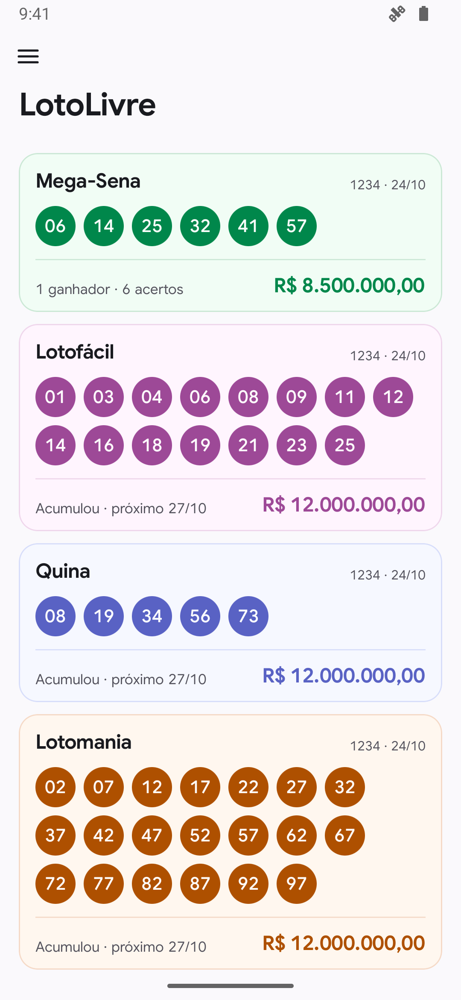
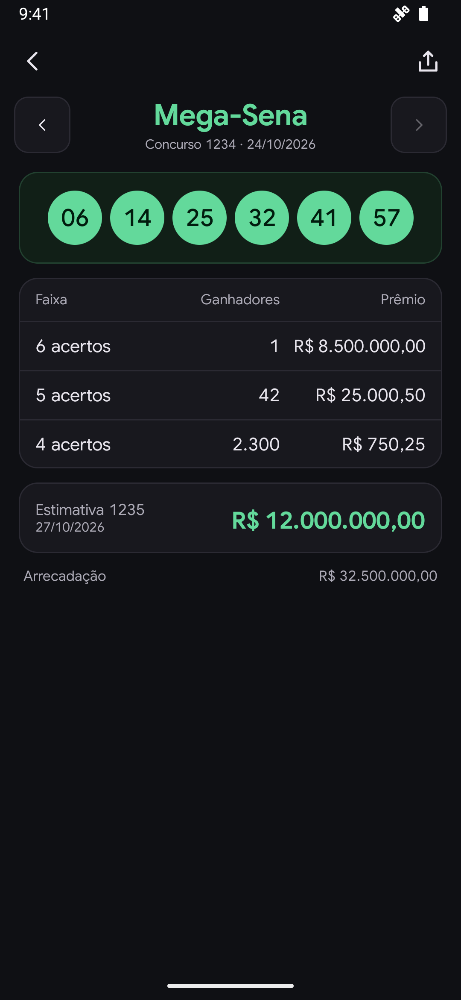

  <picture>
    <source media="(prefers-color-scheme: dark)" srcset="design/logo/logo-celtic-wordmark-dark.svg">
    
  </picture>

  Resultados das loterias federais brasileiras, sem anúncios nem rastreamento.

  <a href="https://github.com/11xx/lotolivre/releases">Releases · APK para Android</a>

Da Mega-Sena à Loteca, os resultados ficam numa única lista. Abra uma modalidade
para ver a premiação, navegar entre concursos e compartilhar o resultado como
imagem. Os concursos consultados ficam no aparelho e abrem mesmo sem internet.

  
  &nbsp;
  

Telas do aplicativo em execução com dados fictícios.

O tema acompanha o sistema ou pode ser escolhido no menu. O aplicativo não gera
jogos, não guarda apostas e não pede cadastro. Os resultados vêm da API do
portal de loterias da Caixa, que não é documentada e pode mudar sem aviso.

LotoLivre é independente, sem afiliação ou endosso da Caixa Econômica Federal.
Os nomes das modalidades são marcas de seus respectivos titulares, usados
para identificar os resultados. O aplicativo não distribui logotipos da Caixa.

Domínio público, sob a [Unlicense](UNLICENSE).
